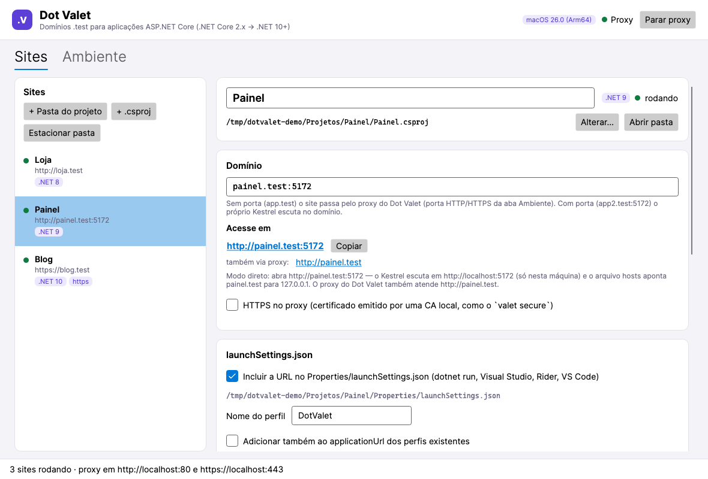
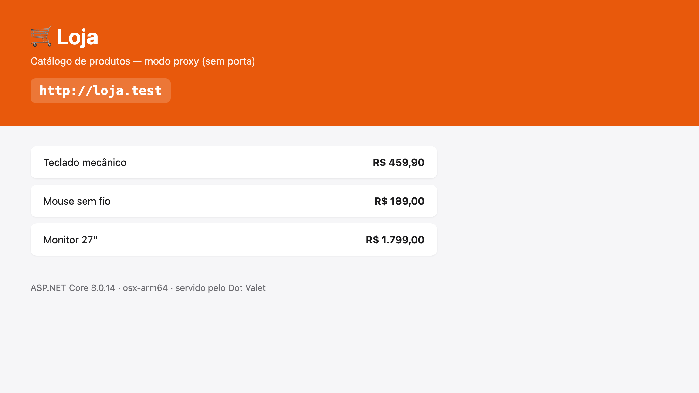
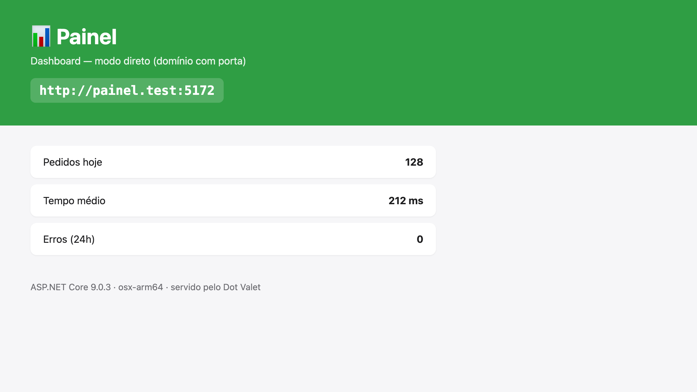
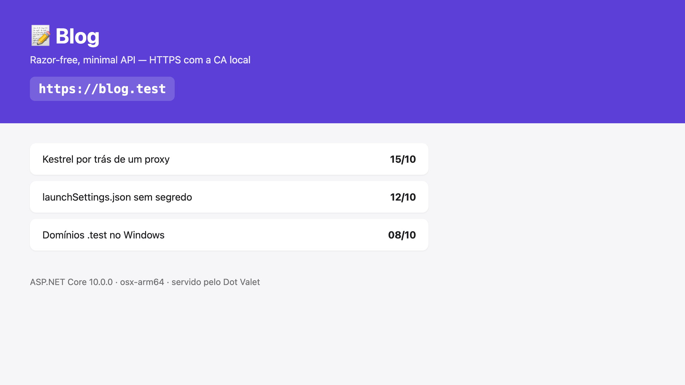
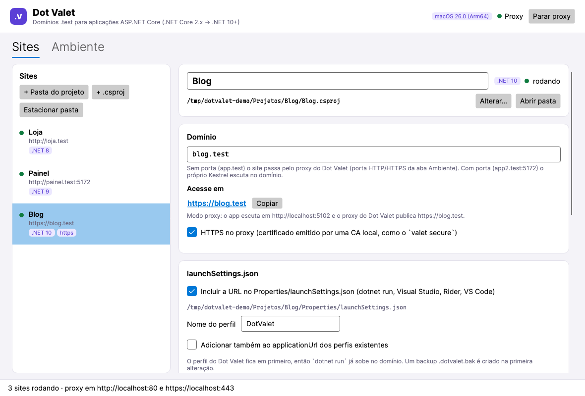
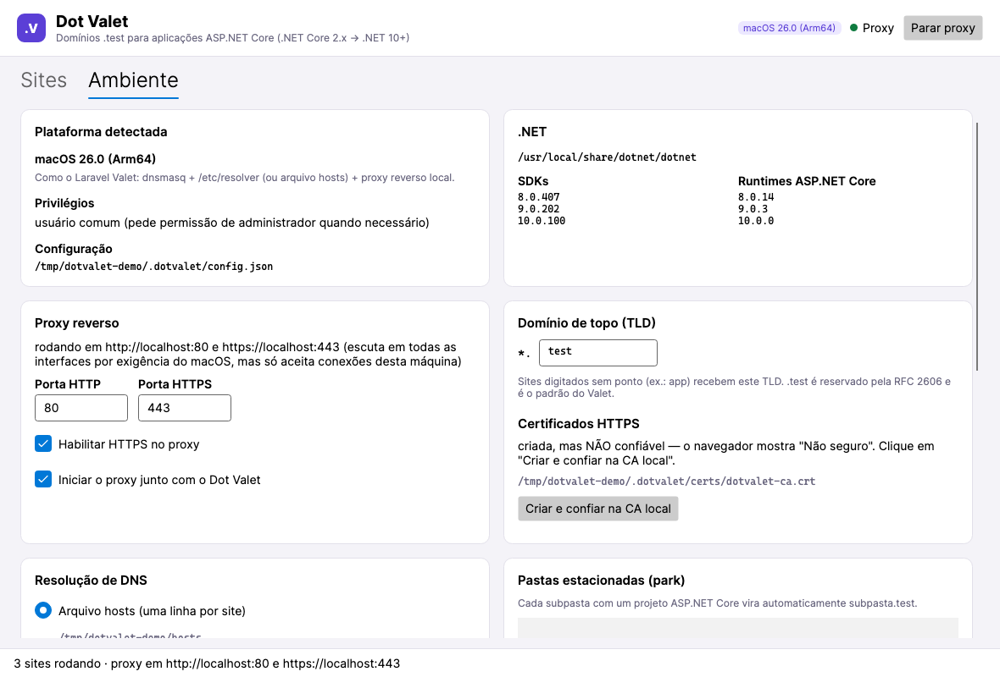

# Dot Valet

[](https://github.com/salesHgabriel/DotValet/actions/workflows/ci.yml)
[](https://github.com/salesHgabriel/DotValet/releases/latest)

Aplicativo desktop (Avalonia, multiplataforma) que faz pelo **ASP.NET Core** o que o
[Laravel Valet](https://github.com/laravel/valet) (macOS), o [valet-linux](https://github.com/cpriego/valet-linux)
e o [Laragon](https://github.com/leokhoa/laragon) (Windows) fazem pelo PHP: cada projeto ganha um domínio
`.test`, com link clicável, HTTPS local opcional e integração com o `launchSettings.json`.

Funciona com projetos **.NET Core 2.x, 3.x, .NET 5, 6, 7, 8, 9, 10** e seguintes.



## Download

Baixe a versão mais recente em [Releases](https://github.com/salesHgabriel/DotValet/releases/latest):

| Sistema | Arquivo |
|---|---|
| Windows (x64 / ARM64) | `DotValet-<versão>-win-x64.zip` / `win-arm64.zip` |
| macOS (Apple Silicon / Intel) | `DotValet-<versão>-osx-arm64.zip` / `osx-x64.zip` (contém `Dot Valet.app`) |
| Linux (x64 / ARM64) | `DotValet-<versão>-linux-x64.tar.gz` / `linux-arm64.tar.gz` |

Os executáveis são self-contained: não é preciso ter o .NET instalado para abrir o Dot Valet (para rodar
seus projetos, sim). No macOS o app não é notarizado — na primeira vez use botão direito → **Abrir** ou
`xattr -dr com.apple.quarantine "/Applications/Dot Valet.app"`.

## Screenshots

### Apps de exemplo rodando em domínios `.test`

Os três projetos de [`samples/`](samples) servidos pelo Dot Valet ao mesmo tempo, cada um em um modo:

| `http://loja.test` — modo proxy | `http://painel.test:5172` — modo direto | `https://blog.test` — HTTPS com CA local |
|---|---|---|
|  |  |  |
| .NET 8, porta interna alocada automaticamente | .NET 9, Kestrel escutando na porta do domínio | .NET 10, proxy com certificado por domínio (SNI) |

### Aplicativo

| Site com HTTPS | Aba Ambiente |
|---|---|
|  |  |


## Como funciona

| Peça | Laravel Valet | Dot Valet |
|---|---|---|
| DNS | dnsmasq + `/etc/resolver/test` | arquivo `hosts` (padrão, todas as plataformas) ou dnsmasq (macOS/Linux) |
| Servidor | nginx → PHP-FPM | proxy reverso embutido (Kestrel + YARP) → Kestrel do seu app |
| `valet link` | | **+ Pasta do projeto** / **+ .csproj** |
| `valet park` | | **Estacionar pasta** (cada subpasta com projeto web vira `subpasta.test`) |
| `valet secure` | | **HTTPS no proxy** (CA local + certificado por domínio via SNI) |

A plataforma é detectada automaticamente e a estratégia exibida na aba **Ambiente**.

### Dois modos de domínio

- **`app` ou `app.test`** — modo proxy. O app escuta em `http://localhost:51xx` (porta alocada
  automaticamente) e o proxy do Dot Valet publica `http://app.test` (ou `https://app.test`).
- **`app2.test:5172`** — modo direto. O navegador abre `http://app2.test:5172`; o `hosts` aponta `app2.test`
  para `127.0.0.1` e o Kestrel escuta em `http://localhost:5172` — só nesta máquina (escutar no domínio faria o
  Kestrel abrir a porta em todas as interfaces, expondo o app na rede). O proxy também atende `http://app2.test` como bônus.

### launchSettings.json

Com a opção **Incluir a URL no launchSettings.json**, o Dot Valet cria (ou atualiza) um perfil — por
padrão `DotValet` — como primeiro perfil do arquivo, então `dotnet run`, Visual Studio, Rider e VS Code
já sobem o app no domínio:

```json
"DotValet": {
  "commandName": "Project",
  "dotnetRunMessages": true,
  "launchBrowser": true,
  "launchUrl": "http://app2.test:5172",
  "applicationUrl": "http://localhost:5172",
  "environmentVariables": { "ASPNETCORE_ENVIRONMENT": "Development" }
}
```

- **Adicionar também ao applicationUrl dos perfis existentes** acrescenta a URL aos perfis `Project`
  que já existem (ex.: `http`, `https`).
- Ao trocar domínio/porta/nome do perfil, a entrada anterior é removida; ao remover o site, tudo
  que o Dot Valet escreveu é desfeito.
- Na primeira alteração é criado `launchSettings.json.dotvalet.bak` (comentários do JSON não são preservados).

### Executar pelo Dot Valet

**▶ Iniciar** roda `dotnet run --no-launch-profile` (ou `dotnet watch run`) com `ASPNETCORE_URLS`
apontando para a URL do site — funciona igual em todas as versões a partir do ASP.NET Core 2.x — e mostra
o log na tela. O app avisa se o runtime ASP.NET Core da versão do projeto não estiver instalado.

## Requisitos

- .NET SDK 8 ou superior para rodar o Dot Valet (o projeto alvo pode usar qualquer versão suportada,
  desde que o runtime correspondente esteja instalado).
- Permissão de administrador quando o arquivo `hosts` ou o DNS precisa ser alterado
  (macOS: diálogo de senha; Linux: `pkexec`; Windows: UAC).

## Rodando

```bash
dotnet run --project src/DotValet
dotnet test
```

Publicação de um executável:

```bash
dotnet publish src/DotValet -c Release -r osx-arm64 --self-contained   # ou win-x64, linux-x64
```

### Apps de exemplo

`samples/` tem três minimal APIs (Loja .NET 8, Painel .NET 9, Blog .NET 10) que mostram na página o
endereço pelo qual foram abertas. Vincule a pasta de cada uma com **+ Pasta do projeto** para testar os
modos proxy, direto e HTTPS. Elas usam `UseForwardedHeaders` para enxergar o `https` original que chega do
proxy em `X-Forwarded-Proto` — faça o mesmo nos seus projetos se eles geram URLs absolutas.

### Atualizando os screenshots

```bash
dotnet run --project tools/DotValet.Screenshots
```

Sobe os exemplos pelo próprio Dot Valet (config, CA e hosts num diretório temporário — o sistema não é
alterado), renderiza a janela sem abri-la (Avalonia headless) e fotografa os sites com o Chrome headless,
que resolve `*.test` para `127.0.0.1` via `--host-resolver-rules`. Precisa do Chrome (ou `CHROME_PATH`),
dos SDKs .NET 8/9/10 e das portas 80/443 livres. As imagens vão para `docs/screenshots/`.

## CI e releases (GitHub Actions)

- [`ci.yml`](.github/workflows/ci.yml) — a cada push/PR compila e roda `dotnet test` no Ubuntu, macOS e Windows,
  além de compilar os exemplos e a ferramenta de screenshots.
- [`release.yml`](.github/workflows/release.yml) — ao enviar uma tag `v*` roda os testes, publica executáveis
  self-contained (single-file) para `win-x64`, `win-arm64`, `osx-arm64`, `osx-x64` (empacotados como
  `Dot Valet.app` com assinatura ad-hoc), `linux-x64` e `linux-arm64`, e cria a release com os arquivos e
  `SHA256SUMS.txt`. Tags com `-` (ex.: `v0.2.0-beta.1`) viram pré-release.

```bash
git tag v0.1.0
git push origin v0.1.0
```

Também dá para rodar manualmente (Actions → Release → Run workflow): gera os artefatos sem criar release.

## Observações por plataforma

- **macOS**: portas 80/443 funcionam sem root — o macOS só permite isso em endereço curinga, então nesse caso
  o proxy escuta em todas as interfaces e derruba qualquer conexão que não venha da própria máquina. Para wildcard `*.test`, use **Instalar/configurar
  dnsmasq** (Homebrew), como o Valet. Se o Laravel Valet estiver instalado, o nginx dele ocupa 80/443: o Dot Valet detecta e avisa;
  pare-o (`valet stop`) ou mude as portas do proxy.
- **Laravel Valet instalado**: o nginx dele ocupa 127.0.0.1:80/443 e o dnsmasq dele responde por `*.test`.
  Para não gerar conflito, o Dot Valet recomenda (aba Ambiente) **parar** o Valet enquanto usa o Dot Valet
  (`valet stop`, botão **Parar o Valet**; `valet start` para voltar) ou **desinstalá-lo** se não usa mais PHP
  (`valet uninstall`). Se precisar dos dois, marque **Integrar com o Valet**: cada site vira um
  `valet proxy app.test http://localhost:51xx` (com `--secure` nos sites HTTPS), aplicado com uma única senha e
  desfeito ao remover o site ou desligar a opção.
- **Linux**: portas < 1024 exigem root; o padrão é 8080/8443. Para usar 80/443:
  `sudo sysctl -w net.ipv4.ip_unprivileged_port_start=80`. O dnsmasq usa o plugin do NetworkManager
  (mesma abordagem do valet-linux).
- **Windows**: usa o arquivo `hosts` (como o Laragon). IIS/Skype/etc. podem ocupar a porta 80.
- **HTTPS**: clique em **Criar e confiar na CA local**. O Firefox usa repositório próprio de certificados.

## Dados

Tudo fica em `~/.dotvalet/` (`config.json`, `certs/` e `backups/`).

### Backup do arquivo hosts

Com **Fazer backup do hosts antes de cada alteração** (ligado por padrão, aba Ambiente), antes de
qualquer mudança no hosts o Dot Valet grava em `~/.dotvalet/backups/`:

- `hosts.principal.bak` — o hosts como estava antes da primeira alteração; criado uma vez e nunca sobrescrito.
- `hosts.ultimo.bak` — o estado imediatamente anterior à alteração mais recente; o anterior é apagado e
  substituído a cada mudança.

Os botões **Restaurar último backup** / **Restaurar backup principal** devolvem o hosts a esses estados
(a restauração também gera um novo "último", então dá para desfazê-la). Se o backup falhar, o hosts não é alterado. As variáveis `DOTVALET_HOME` e
`DOTVALET_HOSTS_FILE` permitem usar outro diretório/arquivo hosts (útil para testes).

## Estrutura

```
src/DotValet/
  Models/        Site, AppConfig
  Services/      DomainParser, SiteEndpoints, ProjectInspector, LaunchSettingsService,
                 HostsFileService, DnsmasqService, CertificateService, ProxyServer,
                 SiteRunner, DotnetEnvironment, Elevation, PlatformInfo, ConfigStore
  ViewModels/    MainViewModel, SiteViewModel
  Views/         MainWindow
tests/DotValet.Tests/
samples/         Loja, Painel, Blog (apps de exemplo)
tools/DotValet.Screenshots/   gera docs/screenshots/
.github/workflows/            ci.yml, release.yml
```
